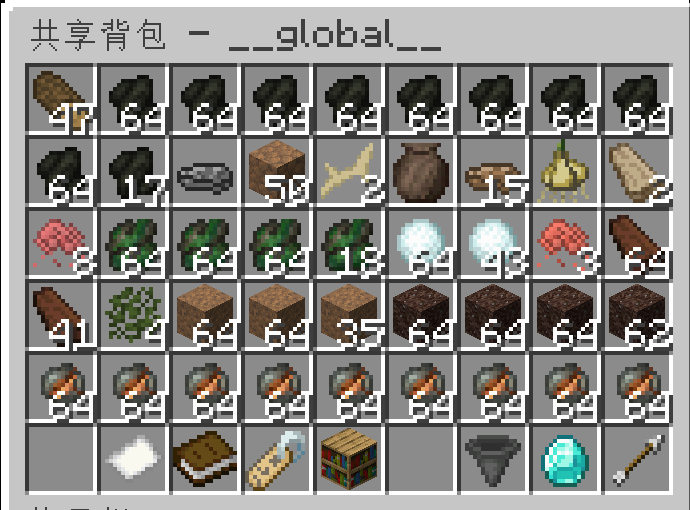
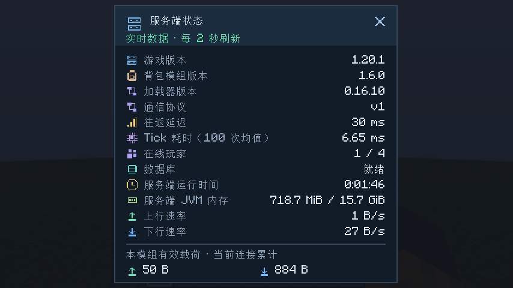

# Shared Backpack / 共享背包

[](https://fabricmc.net/)
[](https://adoptium.net/)
[](LICENSE)



A server-only Minecraft Fabric mod for 1.16.5 and 1.20.1, providing a team-shared backpack with SQLite storage, fuzzy Chinese pinyin search, and player-customizable boxes. A separate, optional client addon adds a search bar and keyboard shortcut.

默认只需安装在服务端的 Minecraft Fabric 模组，支持 1.16.5 与 1.20.1，提供基于 SQLite 的团队共享背包、模糊拼音搜索和玩家自定义盒子。另有独立的可选客户端模组，增加搜索栏和快捷键；不要求玩家安装。

---

## Features / 功能

- **Team backpack** — Items shared across team members; global backpack for solo players
- **Player boxes** — Personal named boxes with independent storage, managed via GUI
- **Fuzzy search** — `/c <text>` with PinIn-powered Chinese pinyin matching, English name, item ID, and namespace search (e.g. `tfc:ore`, `forge:stone`)
- **Mod classification** — Secondary menu groups items by mod namespace with representative icons
- **Unload mode** — `/cc unload` opens a blank 5-row grid for quick dumping
- **NBT preservation** — Original item NBT is stored and restored without adding, stripping, or rewriting display tags
- **SQLite storage** — Auto-backup, transaction-safe, full-NBT comparison for stacking
- **Page navigation** — Diamond-based capacity upgrade; prev/next page buttons
- **Sort** — Consolidate only items with identical IDs and complete NBT; CTM/custom variants remain separate
- **Optional client GUI** — Configurable `B` shortcut, search and clear icons, and an on-demand server status panel with original SVG/pixel icons

### Optional client GUI / 可选客户端界面

| Installation / 安装方式 | Behavior / 行为 |
|------------------------|------------------|
| Server JAR on the server only / 仅服务端安装主模组 | Original commands and chest GUI; clients need no addon / 原有命令和箱子界面，客户端无需安装 |
| Server JAR + selected players install client JAR / 服务端主模组 + 部分玩家安装客户端包 | Those players get the search bar and `B` shortcut / 这些玩家额外获得搜索框和 `B` 快捷键 |
| Client addon on a server without Shared Backpack / 客户端安装后进入未装主模组的服务器 | No backpack enhancements; ordinary chests behave normally / 不启用增强功能，普通箱子照常使用 |

Install `sharedbackpack-client-fabric-<mc>-1.6.0.jar` and Fabric API in the **client's** `mods/` folder. The client addon does not need the server JAR installed locally. Use the same Minecraft version and matching server/client release. It contains no database or server implementation.

将 `sharedbackpack-client-fabric-<mc>-1.6.0.jar` 和对应版本 Fabric API 放到**客户端**的 `mods/`。客户端不需要安装服务端主包，服务端也不需要客户端包；Minecraft 版本与模组发布版本须匹配。

Press `B` while in game to open the backpack; change it under Controls → Shared Backpack. Click the search box at the top of the backpack or box, type a name, pinyin, or item ID, then press Enter or click the magnifier. The X icon clears the filter. Hover icons for their names. Esc first leaves the search field, then closes the screen. Search runs on the server using the existing search logic. Unload mode keeps its original blank grid.

在游戏中按 `B` 打开背包，可在「按键设置 → 共享背包」修改。背包和盒子顶部可输入名称、拼音或物品 ID，按回车或点击放大镜提交，点击 X 清空筛选，悬停图标可查看名称。搜索框获得焦点时第一次 Esc 退出输入，第二次关闭界面。搜索仍由服务端执行；卸货模式保留原来的空白格子。

Click the **i** icon to open server status. It shows Minecraft, backpack mod, Fabric Loader and protocol versions, request RTT, average tick work time, online/max players, database readiness, uptime, JVM heap usage, and addon upload/download rates and totals. It refreshes every two seconds while open. Esc or the close icon returns to the backpack; inventory input is paused while the panel is open.

点击 **i** 信息图标查看服务端状态：游戏/背包模组/加载器/协议版本、请求往返延迟、平均 Tick 执行耗时、在线/最大玩家数、数据库状态、运行时长、JVM 内存，以及本模组上行/下行速率和累计字节数。面板打开时每两秒刷新，按 Esc 或关闭图标返回背包。

Traffic counters measure only Shared Backpack addon payload bytes for the current connection, from the client's perspective. They exclude vanilla item synchronization, other mods, compression, and TCP/IP overhead. RTT includes server scheduling; tick work averages the last 100 server ticks and is not a TPS measurement. Older servers that lack the status endpoint show an unsupported message while search continues to work.

流量统计仅计算当前连接中共享背包扩展协议的有效载荷，方向以客户端为准，不包含原版物品同步、其他模组、压缩或 TCP/IP 开销。延迟包含服务端调度时间；Tick 耗时取最近 100 次执行的均值，不等同于 TPS。旧服务端没有状态接口时会显示未支持，搜索功能仍可使用。

Editable icon source: `client/art/icons.svg`. The game uses the checked-in PNG atlas; regenerate it with `python3 client/art/generate_icons.py` (standard library only).



### Commands / 命令

| Command / 命令 | Description / 说明 |
|----------------|---------------------|
| `/c` | Open shared backpack / 打开共享背包 |
| `/c <search>` | Open with search filter / 打开并搜索 |
| `/cc help` | Show help / 显示帮助 |
| `/cc unload` | Unload mode (no buttons) / 卸货模式 |
| `/cc box create <name>` | Create personal box / 创建个人盒子 |
| `/cc box open <name>` | Open personal box / 打开个人盒子 |
| `/cc box list` | List your boxes / 列出盒子 |
| `/cc box delete <name>` | Delete box / 删除盒子 |
| `/cc admin info <team>` | Team info (op level 2) / 队伍信息 |
| `/cc admin upgrade <team> <pages>` | Add pages (op 2) / 升级页数 |
| `/cc admin backup` | Force DB backup (op 2) / 强制备份 |
| `/cc admin reload` | Reload DB (op 2) / 重载数据库 |
| `/cc search <query>` | Search items (op 2) / 搜索物品 |

### GUI Controls / 界面控制

Bottom row (slots 45-53) is the control bar:

| Slot | Icon | Function |
|------|------|----------|
| 45 | Arrow ◀ | Previous page / 上一页 |
| 46 | Paper | Page indicator / 页码 |
| 47 | Book | Item count / 物品总数 |
| 48 | Name Tag / Chest | Team/Box info, click for box menu / 队伍/盒子，点击管理盒子 |
| 49 | Bookshelf | Mod filter menu / 模组分类菜单 |
| 50 | Compass | Search info (if active) / 搜索信息 |
| 51 | Hopper | Sort/consolidate / 整理物品 |
| 52 | Diamond | Upgrade (+1 page, 1 diamond) / 升级背包 |
| 53 | Arrow ▶ | Next page / 下一页 |

**Click behavior:** Left click = take 1, Right click = take stack, Shift+click = quick move

## Build / 构建

```bash
cd sharedbackpack
./gradlew build -PmcVersion=1.16.5
# Server: build/libs/sharedbackpack-fabric-1.16.5-1.6.0.jar
# Optional client: client/build/libs/sharedbackpack-client-fabric-1.16.5-1.6.0.jar

./gradlew build -PmcVersion=1.20.1
# Server: build/libs/sharedbackpack-fabric-1.20.1-1.6.0.jar
# Optional client: client/build/libs/sharedbackpack-client-fabric-1.20.1-1.6.0.jar

# Build only the server artifact / 仅构建服务端包
./gradlew :build -PmcVersion=1.16.5

# Build only the optional client / 仅构建可选客户端包
./gradlew :client:build -PmcVersion=1.16.5
```

### Dependencies / 依赖

- Minecraft 1.16.5: Fabric Loader 0.14.25+, Fabric API 0.42.0+1.16, Java 8+
- Minecraft 1.20.1: Fabric Loader 0.16.10+, Fabric API 0.92.11+1.20.1, Java 17+
- [SQLite JDBC 3.45.1.0](https://github.com/xerial/sqlite-jdbc)
- [PinIn 1.6.0](https://github.com/Towdium/PinIn) — Chinese pinyin matching

### Deploy / 部署

Install the matching Fabric Loader and Fabric API on the server, then copy the JAR whose Minecraft version exactly matches the server to its `mods/` folder. Stop the server before deploying. The 1.16.5 and 1.20.1 JARs are separate and must not be mixed.

## License / 许可证

MIT
