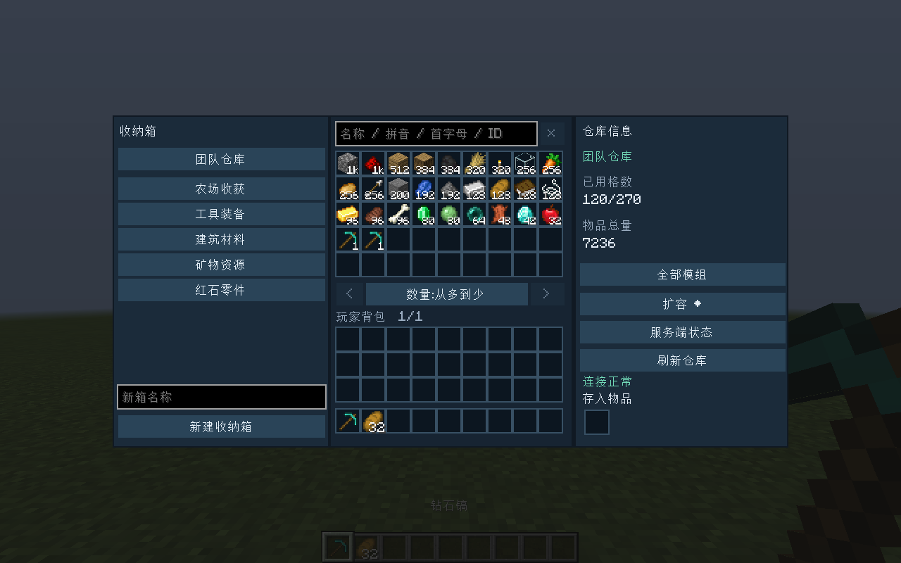

# Shared Backpack / 共享背包

[](https://fabricmc.net/)
[](https://adoptium.net/)
[](LICENSE)

A server-only Minecraft Fabric mod for 1.16.5 and 1.20.1, providing a team-shared backpack with SQLite storage, fuzzy Chinese pinyin search, and player-customizable boxes. An independent optional client addon provides a three-panel warehouse dashboard with aggregate item counts, localized pinyin search, box navigation, and safe quick deposits.

默认只需安装在服务端的 Minecraft Fabric 模组，支持 1.16.5 与 1.20.1，提供基于 SQLite 的团队共享背包、模糊拼音搜索和玩家自定义盒子。独立的可选客户端提供三栏仓储界面、超 64 数量聚合、客户端名称拼音搜索、盒子切换与安全快速存入；不要求所有玩家安装。

---

## Vanilla GUI Controls / 无客户端时的原版界面

The original chest interface remains available when only the server mod is installed.

仅安装服务端模组时，仍使用下图的原版箱子界面，玩家无需安装客户端模组。


Bottom row (slots 45-53) is the control bar:

| Slot | Icon | Function |
|------|------|----------|
| 45 | Arrow ◀ | Previous page / 上一页 |
| 46 | Paper | Page indicator / 页码 |
| 47 | Book | Item count / 物品总数 |
| 48 | Name Tag / Chest | Team/Box info, click for box menu / 队伍/盒子，点击管理盒子 |
| 49 | Bookshelf | Mod filter menu / 模组分类菜单 |
| 50 | Compass | Search info (if active) / 搜索信息 |
| 51 | Hopper | Sort/consolidate / 整理物品 |
| 52 | Diamond | Upgrade (+1 page, 1 diamond) / 升级背包 |
| 53 | Arrow ▶ | Next page / 下一页 |

**Click behavior:** Left click = take 1, Right click = take stack, Shift+click = quick move

## Features / 功能

- **Team backpack** — Items shared across team members; global backpack for solo players
- **Player boxes** — Personal named boxes with independent storage, managed via GUI
- **Fuzzy search** — `/c <text>` with PinIn-powered Chinese pinyin matching, English name, item ID, and namespace search (e.g. `tfc:ore`, `forge:stone`)
- **Mod classification** — Secondary menu groups items by mod namespace with representative icons
- **Unload mode** — `/cc unload` opens a blank 5-row grid for quick dumping
- **NBT preservation** — Original item NBT is stored and restored without adding, stripping, or rewriting display tags
- **SQLite storage** — Auto-backup, transaction-safe, full-NBT comparison for stacking
- **Page navigation** — Diamond-based capacity upgrade; prev/next page buttons
- **Sort** — Consolidate only items with identical IDs and complete NBT; CTM/custom variants remain separate
- **Optional warehouse dashboard** — Configurable `B` shortcut; box sidebar, virtual item grid, inventory and deposit slot, capacity/status sidebar, local pinyin search, and remembered page/sort per player and storage

### Optional client GUI / 可选客户端界面



| Installation / 安装方式 | Behavior / 行为 |
|------------------------|------------------|
| Server JAR on the server only / 仅服务端安装主模组 | Original commands and chest GUI; clients need no addon / 原有命令和箱子界面，客户端无需安装 |
| Server JAR + selected players install client JAR / 服务端主模组 + 部分玩家安装客户端包 | Those players get the independent dashboard, aggregate counts and local search / 这些玩家获得独立仓储界面、聚合数量与本地搜索 |
| Client addon on a server without Shared Backpack / 客户端安装后进入未装主模组的服务器 | No backpack enhancements; ordinary chests behave normally / 不启用增强功能，普通箱子照常使用 |

Install `sharedbackpack-client-fabric-<mc>-1.7.0.jar` and Fabric API in the **client's** `mods/` folder. The client addon does not need the server JAR installed locally. Use the same Minecraft version and matching server/client release. It contains no database or server implementation. A 1.7.0 client on an older compatible server keeps the original search-bar enhancement instead of the new dashboard.

将 `sharedbackpack-client-fabric-<mc>-1.7.0.jar` 和对应版本 Fabric API 放到**客户端**的 `mods/`。客户端不需要安装服务端主包，服务端也不需要客户端包；Minecraft 版本与模组发布版本须匹配。新仓储界面需要 1.7.0 服务端；连接支持旧搜索协议的服务端时，仍使用原搜索栏增强界面。

Press `B` to open the warehouse; change the shortcut under Controls → Shared Backpack. The left sidebar switches between the team warehouse and named boxes, and creates boxes from the name field (blank generates a name). Search filters immediately using the client's localized item names, full pinyin, initials, and item IDs; namespace filtering and six sorting modes work locally. Each player/storage remembers the unfiltered page and sort in the server database, including after restart. Clearing search restores the remembered page. Unload mode retains its original blank container.

按 `B` 打开仓库，可在「按键设置 → 共享背包」修改。左侧直接切换团队仓库与盒子，输入名称后可创建盒子，留空则自动命名。顶部按客户端实际显示名称即时搜索，支持中文、全拼、首字母和物品 ID；可筛选模组并切换六种排序。服务端数据库按玩家、仓库分别保存未筛选页数及排序，重启后仍保留，清空搜索可回到记住的页数。卸货模式继续使用原有空白容器。

Click **Server status** in the right sidebar to open diagnostics. It shows Minecraft, backpack mod, Fabric Loader and protocol versions, request RTT, average tick work time, online/max players, database readiness, uptime, JVM heap usage, and addon upload/download rates and totals. Status refreshes every two seconds while the dashboard is open. Esc or the close icon returns from diagnostics; covered inventory input is blocked.

点击右侧 **服务端状态** 打开诊断面板：显示游戏/背包模组/加载器/协议版本、请求往返延迟、平均 Tick 执行耗时、在线/最大玩家数、数据库状态、运行时长、JVM 内存及本模组上行/下行流量。仓储界面打开时每两秒更新状态；诊断面板用 Esc 或关闭图标返回，覆盖期间禁止操作底下的物品。

Traffic counters measure only Shared Backpack addon payload bytes for the current connection, from the client's perspective. They exclude vanilla item synchronization, other mods, compression, and TCP/IP overhead. RTT includes server scheduling; tick work averages the last 100 server ticks and is not a TPS measurement. Older servers that lack the status endpoint show an unsupported message while search continues to work.

流量统计仅计算当前连接中共享背包扩展协议的有效载荷，方向以客户端为准，不包含原版物品同步、其他模组、压缩或 TCP/IP 开销。延迟包含服务端调度时间；Tick 耗时取最近 100 次执行的均值，不等同于 TPS。旧服务端没有状态接口时会显示未支持，搜索功能仍可使用。

Editable icon source: `client/art/icons.svg`. The game uses the checked-in PNG atlas; regenerate it with `python3 client/art/generate_icons.py` (standard library only).


### Commands / 命令

| Command / 命令 | Description / 说明 |
|----------------|---------------------|
| `/c` | Open shared backpack / 打开共享背包 |
| `/c <search>` | Open with search filter / 打开并搜索 |
| `/cc help` | Show help / 显示帮助 |
| `/cc unload` | Unload mode (no buttons) / 卸货模式 |
| `/cc box create <name>` | Create personal box / 创建个人盒子 |
| `/cc box open <name>` | Open personal box / 打开个人盒子 |
| `/cc box list` | List your boxes / 列出盒子 |
| `/cc box delete <name>` | Delete box / 删除盒子 |
| `/cc admin info <team>` | Team info (op level 2) / 队伍信息 |
| `/cc admin upgrade <team> <pages>` | Add pages (op 2) / 升级页数 |
| `/cc admin backup` | Force DB backup (op 2) / 强制备份 |
| `/cc admin reload` | Reload DB (op 2) / 重载数据库 |
| `/cc search <query>` | Search items (op 2) / 搜索物品 |

### Dashboard Controls / 客户端仓储操作

| Action / 操作 | Result / 效果 |
|----------------|----------------|
| Left-click an entry / 左键目录物品 | Take one to the cursor / 取出 1 个到鼠标 |
| Right-click an entry / 右键目录物品 | Take up to one normal item stack / 取出一组，遵守该物品堆叠上限 |
| Shift+left-click an entry / Shift+左键目录物品 | Take a normal stack directly into inventory, limited by free space / 将一组直接取到玩家背包，受空位限制 |
| Shift+left-click player inventory / Shift+左键玩家背包 | Atomically store that stack; clear only after server confirmation / 整组存入，服务端成功确认后才清空原格 |
| Click the right-side deposit slot with a carried item / 手持物品点击右侧投入格 | Store the carried stack, then clear it; full/failed storage keeps the item / 存入后自动清空，满仓或失败时保留原物品 |
| Bottom arrow / sort buttons / 下方箭头与排序按钮 | Page navigation; insertion, quantity descending/ascending, newest/oldest, localized name / 翻页；原始格位、数量多到少/少到多、最新/最早、客户端名称排序 |
| Right sidebar / 右侧按钮 | Namespace filter, diamond upgrade, diagnostics, refresh / 模组筛选、钻石扩容、诊断、刷新 |

Identical item IDs **and complete NBT** share one virtual catalog entry, whose count can exceed 64; hover for the exact count. Durability, names, enchantments, maps and mod tags remain distinct. This does not create oversized inventory stacks or remove storage capacity limits: the database keeps compatible physical rows of at most 64, and the capacity panel reports those rows. Deposits commit in full or not at all. Items that could not be stored remain with the player; an uncommitted deposit slot is returned on close.

物品 ID 和 **完整 NBT** 相同才合并为一个虚拟目录格，数量可超过 64，悬停可查看精确总数；耐久、名称、附魔、地图和模组标签不同仍分别显示。聚合不会生成超量的原版物品堆，也不取消容量限制：数据库保留每行最多 64 个的兼容存储，右侧容量显示实际占用行数。存入要么整组成功，要么完全不写入；失败不清空物品，关闭时未提交的投入格会退回玩家。

## Build / 构建

```bash
cd sharedbackpack
./gradlew build -PmcVersion=1.16.5
# Server: build/libs/sharedbackpack-fabric-1.16.5-1.7.0.jar
# Optional client: client/build/libs/sharedbackpack-client-fabric-1.16.5-1.7.0.jar

./gradlew build -PmcVersion=1.20.1
# Server: build/libs/sharedbackpack-fabric-1.20.1-1.7.0.jar
# Optional client: client/build/libs/sharedbackpack-client-fabric-1.20.1-1.7.0.jar

# Build only the server artifact / 仅构建服务端包
./gradlew :build -PmcVersion=1.16.5

# Build only the optional client / 仅构建可选客户端包
./gradlew :client:build -PmcVersion=1.16.5
```

### Dependencies / 依赖

- Minecraft 1.16.5: Fabric Loader 0.14.25+, Fabric API 0.42.0+1.16, Java 8+
- Minecraft 1.20.1: Fabric Loader 0.16.10+, Fabric API 0.92.11+1.20.1, Java 17+
- [SQLite JDBC 3.45.1.0](https://github.com/xerial/sqlite-jdbc)
- [PinIn 1.6.0](https://github.com/Towdium/PinIn) — Chinese pinyin matching

### Deploy / 部署

Install the matching Fabric Loader and Fabric API on the server, then copy the JAR whose Minecraft version exactly matches the server to its `mods/` folder. Stop the server before deploying. The 1.16.5 and 1.20.1 JARs are separate and must not be mixed.

## License / 许可证

MIT
